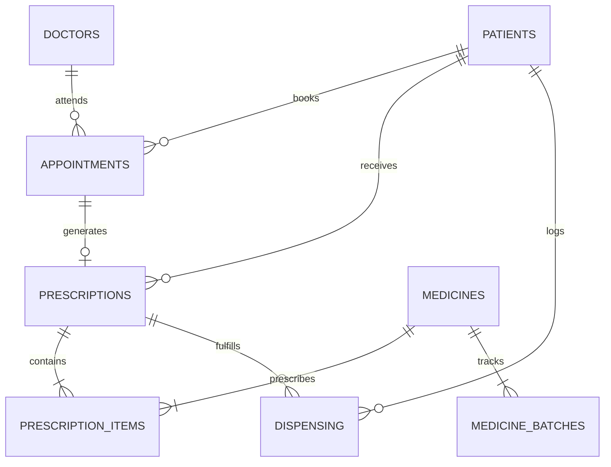

# Thapar University Dispensary Management System

> **Software Engineering Project** · **Java Backend** · **MySQL Relational Schema**  
> **Thapar Institute of Engineering & Technology (TIET), Patiala**

A centralized, digital healthcare and dispensary management system designed to computerize the daily healthcare operations of Thapar University. The system eliminates paper registers for patient visits, doctor consultations, appointment queues, medicine stock tracking, and prescription dispensing.

---

## 🌟 Key Highlights

- **5 Dedicated Portals**:
  1. 🎓 **Student / Patient Portal**: Live token booking, real-time wait queue tracker, digital prescription viewer, downloadable university sick leave slips.
  2. 🩺 **Doctor Consultation Chamber (PC View)**: Real-time patient token alerts, instant retrieval of full student profile, **prominent drug allergy & chronic illness safety banners**, vitals recording, diagnosis, and live inventory e-prescriptions.
  3. 💊 **Medicine Inventory & Dispensing Desk**: Catalog tracking, low-stock alerts, 60-day expiry monitoring, inward restock, and **1-click dispensing with automatic stock deduction** (e.g., 200 − 12 = 188).
  4. 📋 **Receptionist Front-Desk**: Fast patient registration by roll number/employee ID, emergency contact tracking, walk-in token issuance, and schedule management.
  5. 🛡️ **Administrator & Analytics**: Executive KPI statistics, campus illness/epidemiology distribution meters, staff account administration, and tamper-evident audit logs.
- **Automated Core Workflow**:  
  $$\text{Student Token} \longrightarrow \text{Doctor PC Consultation} \longrightarrow \text{E-Prescription} \longrightarrow \text{Pharmacy Dispense} \longrightarrow \text{Auto Stock Deduction}$$
- **Zero External Dependencies Required**:  
  Runs instantly on Java 21+ using the JDK's built-in HTTP server and thread-safe persistent datastore, while also including a complete MySQL 8.0 DDL script (`database/schema.sql`) and standard Maven `pom.xml`.

---

## 🚀 Quick Start Guide

### 1. Compile the Project
```bash
./compile.sh
```

### 2. Run the Server
```bash
./run.sh
```
*(Default port is `8080`. You can optionally specify a custom port: `./run.sh 9090`)*

### 3. Open in Browser
Visit: **[http://localhost:8080](http://localhost:8080)**

---

## 🔑 Pre-Configured Demo Accounts

| Role | Username | Password | Full Name / Description |
| :--- | :--- | :--- | :--- |
| **Admin** | `admin` | `admin123` | Dr. Vikramjit Singh (Chief Medical Superintendent) |
| **Doctor** | `doctor` | `doctor123` | Dr. Ananya Sharma, MD (Chamber 1) |
| **Receptionist** | `reception` | `reception123` | Mr. Gurpreet Singh (Front Desk) |
| **Pharmacist** | `pharma` | `pharma123` | Mr. Rakesh Verma, B.Pharm (Dispensary Pharmacy) |
| **Student 1** | `102103456` | `student123` | Aarav Patel (3rd Year, CSED) · *Allergic to Penicillin* |
| **Student 2** | `102204123` | `student123` | Priya Nair (2nd Year, ECED) · *Allergic to Sulfa* |
| **Student 3** | `102008765` | `student123` | Rohan Gupta (4th Year, MED) |
| **Student 4** | `102301987` | `student123` | Sneha Rao (1st Year, CHED) |

*(Note: The landing page at `http://localhost:8080` features **1-click quick login cards** for instant evaluation without typing credentials.)*

---

## 📂 Project Structure

```
Lab-project/
├── compile.sh                              # 1-second javac compilation script
├── run.sh                                  # 1-click startup script (port 8080)
├── pom.xml                                 # Standard Maven configuration
├── database/
│   └── schema.sql                          # Complete MySQL 8.0+ DDL & DML script
├── data/                                   # Persistent JSON datastore (auto-seeded)
│   ├── users.json
│   ├── students.json
│   ├── doctors.json
│   ├── appointments.json
│   ├── medicines.json
│   ├── prescriptions.json
│   └── dispense_records.json
└── src/
    └── main/
        ├── java/com/college/dispensary/
        │   ├── Main.java                   # Server entrypoint & route registration
        │   ├── config/AppConfig.java       # Campus configuration & contact numbers
        │   ├── model/                      # Entity models (Doctor, Student, Token, Medicine, etc.)
        │   ├── repository/DataStore.java   # Persistent thread-safe datastore
        │   ├── service/                    # Business logic & validations
        │   ├── handler/                    # REST API & static file handlers
        │   └── util/                       # JSON & HTTP utilities
        └── resources/web/                  # Responsive web frontend
            ├── index.html                  # Landing hub & quick-launch cards
            ├── student.html                # Student health & appointment portal
            ├── doctor.html                 # Doctor PC consultation workstation
            ├── inventory.html              # Medicine inventory & dispensing desk
            ├── receptionist.html           # Front-desk patient registration
            ├── admin.html                  # Executive analytics & audit logs
            ├── css/style.css               # Thapar crimson brand theme & print layout
            └── js/app.js                   # Client REST client & session management
```

---

## 🏥 Detailed Module Breakdown

### 1. Patient Management Module
- Maintains records of students, faculty, and university staff.
- Fields: Roll No/Staff ID, Name, Department (CSED, ECED, MED, CHED, CED, Biotechnology), Year, Gender, Age, Blood Group, Drug Allergies, Chronic Illnesses, Emergency Contact Name & Phone.
- Searchable by name, roll number, or department.

### 2. Doctor Management Module
- Doctor profiles with medical specialization, chambers, duty hours, and real-time availability status.
- Chamber 1: Dr. Ananya Sharma (MD Medicine)
- Chamber 2: Dr. Rajesh Verma (MBBS, DNB)
- Chamber 3: Dr. Harpreet Kaur (MBBS, DGO)

### 3. Appointment & Live Token Queue Management Module
- Students can book scheduled appointments by choosing a doctor, date, and available time slot.
- **Double-booking prevention**: The system prevents appointment conflicts for the same doctor and time slot.
- **Live Queue Token Generation**: Generates queue tokens (e.g. `#101`) with priority triage (`NORMAL`, `URGENT`, `EMERGENCY`).
- Real-time queue tracker informs students of current token serving and estimated wait time.

### 4. Doctor Consultation Module (Received on Doctor's PC)
- When a doctor calls a patient, the student's complete medical dossier immediately displays on the screen:
  - Personal details & department
  - 🚨 **High-Visibility Drug Allergy Alert**: Highlights contraindications (e.g., Penicillin allergy warning) to prevent medical malpractice.
  - Vitals Recording: Blood pressure, temperature, pulse rate, weight.
  - Clinical findings: Chief complaints, diagnosis, and physician observations.
  - Past consultation and prescription history.

### 5. Prescription & Sick Leave Certificate Module
- Interactive prescription builder with medicine selection from live inventory.
- Prescribes exact dosage (e.g. `1-0-1 After Meals`), duration (e.g. `3 Days`), quantity, and specific instructions.
- **Official University Medical Rest / Sick Leave Slip**:
  - Medical officers can recommend sick leave with dates and rest advice.
  - Printable official format with Thapar University header and signature stamp for submission to Department HODs/Hostel Wardens.

### 6. Medicine Inventory Management Module
- Complete medicine catalog with brand names, generic formulas, categories (Tablets, Syrups, First-Aid, Injections, Ointments), batch numbers, and rack locations.
- **Automated Alerts**:
  - Low stock warning whenever available stock falls below minimum threshold.
  - Expiry warning for medicines expiring within 60 days.
  - Immediate red flag for expired items.
- Inward restocking form to record new batches and quantities received.

### 7. Medicine Dispensing Module
- Live feed of pending prescriptions sent from the doctor's chamber.
- Pharmacist inspects items and clicks **"Dispense & Auto-Deduct Stock"**.
- System validates stock, deducts issued quantities, records the batch number and pharmacist name, and marks the prescription as `DISPENSED`.

### 8. Admin Dashboard & Reporting Module
- Executive summary metrics (Total patients, active doctors, today's appointments, completed visits, stock alerts).
- Campus Illness / Epidemiology breakdown (Viral Fever, Allergic Rhinitis, Sports Injuries, Gastritis).
- User account creation and role assignment.
- Chronological security and activity audit log.
- Full system data backup export (JSON).

---

## 🗄️ Relational Database Schema (`database/schema.sql`)

The project includes an enterprise-grade relational schema matching the Software Engineering specification:



### Table Summary:
- `users`: User credentials and role-based permissions (`ADMIN`, `DOCTOR`, `RECEPTIONIST`, `PHARMACIST`, `STUDENT`).
- `patients`: Student/staff demographic and clinical profiles.
- `doctors`: Doctor profiles, chambers, and duty schedules.
- `appointments`: Scheduled consultations and tokens with status tracking (`Pending`, `Confirmed`, `Completed`, `Cancelled`).
- `prescriptions`: Electronic medical prescriptions and university sick leave authorizations.
- `prescription_items`: Medicine lines with dosage, frequency, and duration.
- `medicines`: Dispensary medicine catalog and stock thresholds.
- `medicine_batches`: Batch numbers, expiry dates, and inward quantities.
- `dispensing`: Completed dispensary dispensing transactions.
- `audit_logs`: Activity tracking with timestamps, users, roles, and actions.

---

## 🎓 Software Engineering Viva & Presentation Points

1. **Automation Over CRUD**:
   - Rather than isolated forms, actions trigger cascade updates: Doctor Consultation $\to$ E-Prescription $\to$ Pharmacy Queue $\to$ Inventory Stock Deduction $\to$ Student History.
2. **Patient Safety Architecture**:
   - The Doctor PC view immediately flags critical drug allergies (e.g. Penicillin) and warns if an allergic substance is selected.
3. **Queue & Token Fairness**:
   - Tokens are served by priority (`EMERGENCY` / `URGENT` triage over `NORMAL`), keeping the university dispensary prepared for acute sports injuries or high fevers.
4. **Portability & Zero Setup Friction**:
   - Evaluators can review the project on any machine without having to install MySQL or external libraries; the system runs immediately on standard Java and saves data persistently.

---

*Developed for Thapar Institute of Engineering & Technology, Patiala.*
